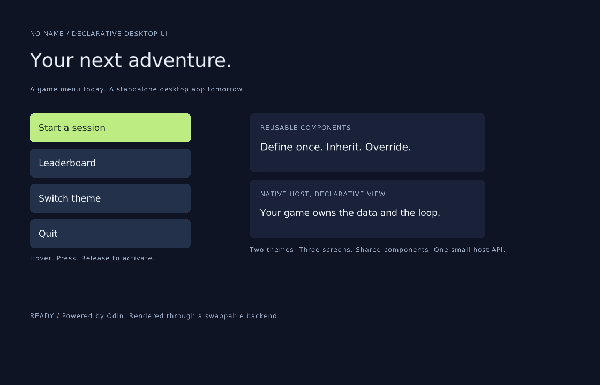

# NO NAME — declarative desktop UI

Describe the view in `.rss`. Keep the application in Odin.

Use the same UI library for a game menu, a leaderboard, an overlay, or a standalone desktop window. The language provides structure, reusable components, themes, layout, and interaction styles. Your program supplies data and decides what a click does.



```rss
theme Game active { accent: #bded82 }

component Action : Button {
    width: 240 height: 48
    background: $accent
    text_color: black
    text_align: center
    text_vertical_align: middle
    hover { background: #d7ffa6 }
    pressed { background: #8db95b }
}

screen Menu active {
    width: 800 height: 600 padding: 32
    layout: vertical gap: 16
    Text #score { height: 32 content: "Score: 0" }
    Action #play { content: "Play" }
}
```

## Run it

Install [Odin](https://odin-lang.org/docs/install/). The standalone demo uses Odin's bundled raylib and a bundled DejaVu font. On Linux, install your distribution's C compiler and X11 development libraries (`clang`, `libx11-dev` on Debian/Ubuntu).

From this repository's root:

```sh
odin run .
odin run examples/embedded
```

The standalone showcase has a menu, a session screen, a leaderboard, and two themes. Start a session, earn points, view scores, and switch themes. The Odin host owns the score, starting at 5000; the UI receives formatted text and returns clicks.

The embedding example draws an interactive HUD inside an existing game window. The original Nightfall example is preserved:

```sh
odin run . -- examples/nightfall.rss
```

## Embed in your project

Copy `ui/` and `graphics/`, then use the raylib adapter or implement your own backend. You can also keep this repository as a vendored dependency and adjust the import paths. There are no third-party UI framework dependencies.

```odin
import ui "path/to/NO_Name/ui"
import backend "path/to/NO_Name/backends/raylib"

// Once, after your game has created its window:
doc, err := ui.load_file("menu.rss")
// Handle err before using doc. On failure, the caller deletes the error string.
defer ui.destroy(doc)
graphics := backend.create()

// Each frame, in your own window/frame loop:
event := ui.update(doc, ui.Input{
    pointer_x = mouse_x, pointer_y = mouse_y,
    pointer_down = mouse_down,
    pointer_pressed = mouse_pressed,
    pointer_released = mouse_released,
    cancel = lost_focus,
}, ui.Rect{width = window_width, height = window_height})

if event.kind == .Click && event.target.instance_id == "play" {
    // Start your game, open another screen, or run your own callback.
}
if !event.handled {
    // Your world may handle the pointer outside the UI.
}
ui.set_text(doc, ui.find_child(doc.root, "score"), "Score: 1200")

// Between your host's BeginDrawing and EndDrawing, after drawing your world:
ui.draw(doc, &graphics)
```

See [the complete embedding example](examples/embedded/main.odin), [the host API](docs/embedding.md), and [the language guide and grammar](docs/language.md).

## Check and test

The library and checker build without raylib, X11, or a display:

```sh
odin test ui
odin run tools/check -- design.rss
odin run tools/check -- examples/nightfall.rss
```

To build the standalone host and embedding example:

```sh
odin build . -out:no-name
odin build examples/embedded -out:embedded
```

A bounded graphical smoke run is available for CI:

```sh
./no-name --frames 3 --screenshot preview.png
```

Linux CI runs the language/runtime tests, validates both examples, builds both hosts, and smoke-runs the standalone host under Xvfb. Odin is pinned to `dev-2026-11a` in CI.

## Structure

| Path | Responsibility |
| --- | --- |
| `ui/lexer.odin`, `ui/parser*.odin`, `ui/syntax.odin` | Source text to syntax tree |
| `ui/semantic*.odin`, `ui/properties.odin` | Names, types, capabilities, themes, diagnostics |
| `ui/component_merge.odin`, `ui/runtime.odin` | Inheritance, overrides, nested instances |
| `ui/resolver.odin`, `ui/layout.odin` | Computed values and geometry |
| `ui/document.odin`, `ui/input.odin` | Public document, data, screen, and event API |
| `ui/render.odin`, `ui/text_layout.odin` | Backend-independent drawing and text flow |
| `graphics/api.odin` | Backend contract: boxes, text, text measurement |
| `backends/raylib/` | Raylib adapter; no language or UI-tree logic |
| `backends/recording/` | Headless backend that records drawing commands |
| `main.odin` | Standalone host and demo application logic |
| `examples/embedded/` | Integration into an existing game loop |

## Prototype scope

Implemented: themes, component inheritance and composition, local child IDs, property/state overrides, three layout modes, host text updates, host navigation/theme switching, captured pointer clicks, rounded boxes/borders, aligned and wrapped UTF-8 text, and independent rendering backends.

This is an initial prototype. It has no scripting language, automatic reactive bindings, keyboard/gamepad focus, scrolling/clipping, animations, grid/flex/percentage sizing, or image rendering. `Image`/`source` and `font` remain reserved syntax from the original experiment; image nodes and nonempty `font` properties report an unsupported-feature error. The raylib host selects a font for the whole graphics context. UTF-8 boundaries are preserved; glyph coverage and shaping depend on the renderer/font.

See [the resolved inconsistencies and remaining limits](docs/design-decisions.md). MIT license; the bundled font has its [own license](assets/FONT-LICENSE.txt).
