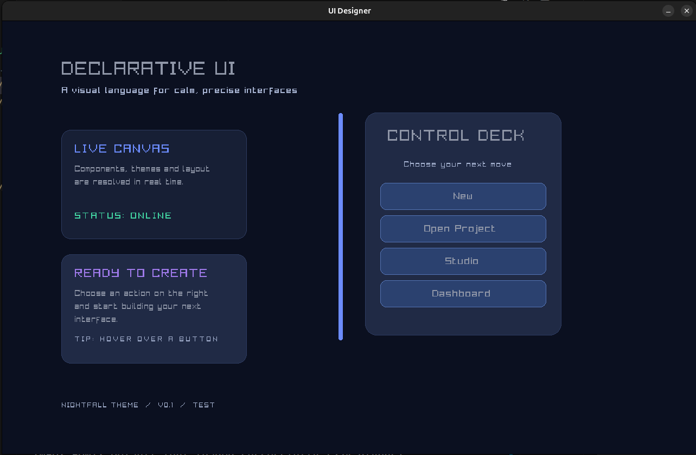

# Declarative UI Designer v0.1

A declarative UI Designer Language inspired by CSS. Written fully in Odin.


 
Output of design.rss

## Quick Run:
``` bash 
$ odin run .
```

Odin required obviously to compile. Modify design.rss to create new decorative windows.
